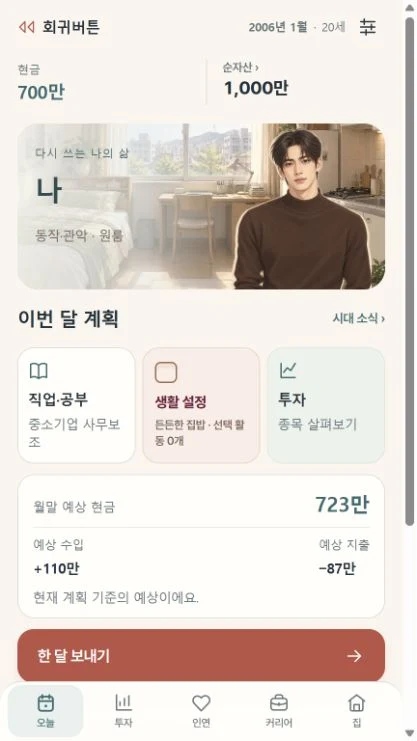
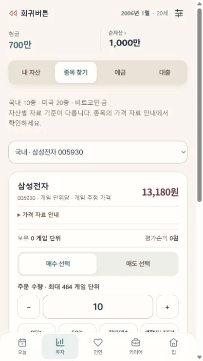
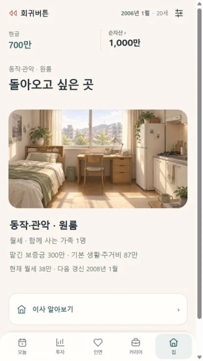

# 회귀버튼 · Hoegwi Button

2006년으로 돌아가 투자, 직업, 주거, 관계를 한 달씩 선택하는 Android 인생 시뮬레이션입니다. 2026년 11월 11일 Google Play에 공개 출시했습니다.

[Google Play에서 보기](https://play.google.com/store/apps/details?id=com.hoegwibutton.game) · [공식 게임 소개](https://detailoopgames.com/ko/games/hoegwi-button/)

| 월간 생활 | 투자 | 주거 |
| :---: | :---: | :---: |
|  |  |  |

화면은 0.50.3 버전의 플레이 화면입니다.

## 기획과 출시

- 과거로 돌아가 투자한다는 아이디어를 월 단위 인생 시뮬레이션으로 기획했습니다. 투자에 쓴 돈이 이후 생활 선택에도 영향을 주도록 예산, 직업, 주거를 한 흐름으로 설계했습니다.
- 제품 콘셉트, 게임 규칙, 화면 요구사항과 첫 버전의 범위를 정했습니다. 실행본을 플레이하면서 문제를 찾고 수정 우선순위를 결정했으며 Google Play 출시를 진행했습니다.
- 코드와 이미지 제작, 빌드, 검증 과정에는 AI 도구를 활용했습니다.

## 기술과 검증

게임은 JavaScript 기반 웹 화면을 Android 앱의 WebView에서 실행하는 구조입니다.

- [월간 계획 화면](samples/monthly-plan.js)은 0.50.3의 실제 화면 코드 발췌입니다. 다음 달의 수입·지출·예상 잔액을 보여주고, 이벤트 대기 중에는 기존 게임 화면으로 전환합니다. 예산이 부족하면 3개월 연속 진행 버튼을 비활성화합니다.
- [발췌 코드 테스트](samples/monthly-plan.test.cjs)는 가상 상태를 넣어 예산 부족과 이벤트 대기 동작을 확인합니다. Node.js에서 `node --test samples/monthly-plan.test.cjs`로 실행할 수 있습니다.
- [기존 엔진 검증 요약](samples/engine-check-summary.json)은 개발 당시 0.41.1과 0.50.3 간 상태 전이 비교 기록을 정리한 것입니다. 당시 기록은 명령 16건 비교와 3개월 정산 완료를 보여줍니다.

이 저장소에는 포트폴리오용 화면, 일부 코드와 검증 자료를 담았습니다. 실제 게임은 Google Play에서 이용할 수 있습니다.

## English summary

Hoegwi Button is an Android life sim about revisiting 2006 and making monthly choices about work, investing, housing, and relationships. I defined the product, designed the rules and screens, prioritized fixes after playtesting, and brought the game to Google Play. I used AI tools to assist with implementation, art, builds, and verification.
